  
  &nbsp;
  

 

<picture>
  <source media="(prefers-color-scheme: dark)" srcset="assets/h-currently-dark.svg">
  
</picture>

  
  

 

<picture>
  <source media="(prefers-color-scheme: dark)" srcset="assets/h-projects-dark.svg">
  
</picture>

  
  

  
  

  
  

Source code: <a href="https://github.com/efefdev/Mahzen">Mahzen</a> · <a href="https://github.com/efefdev/nobetci">Nöbetçi</a> · <a href="https://github.com/efefdev/efefdev.github.io">efef.dev</a>

  

<picture>
  <source media="(prefers-color-scheme: dark)" srcset="assets/h-stack-dark.svg">
  
</picture>

  

<picture>
  <source media="(prefers-color-scheme: dark)" srcset="assets/h-contact-dark.svg">
  
</picture>

  
  &nbsp;
  

